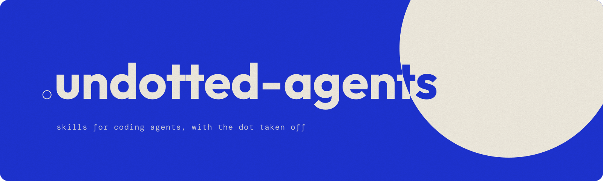

# undotted-agents

The skills I run every day, made public.

## Why undotted-agents

I keep my coding-agent setup in a private `~/.agents` repo. It contains: skills, agent types, hooks, global instructions / system prompts, etc. That Claude Code and Pi load. Plus a small CLI that pulls skills from pinned upstream repos, toggles them on and off, and links everything into each harness. The point of that private repo was to have everything in one place, organized, and that i can easily toggle certain skills for context management.

A dotfolder is hidden by default, and so is that repo. Some of what I write there is worth sharing, so this repo is that part with the dot taken off. Its the same layout (thats why the skills folder is `skills-standalone` and not just `skills`), but public. All skills are written and tested in `~/.agents` and exported here, so treat this repo as a mirror, not the source.

## Skills

<!-- skills:start -->
<!-- skills:end -->

## Install

Pick one route per agent: the plugin and a copied skill both install
`autopilot`, so using both gives it to that agent twice.

**Claude Code, every skill as a plugin:**

```
/plugin marketplace add MarkoPvlkvc/undotted-agents
/plugin install undotted@undotted-agents
```

Skills show as `/undotted:<skill>` (for example `/undotted:autopilot`); the
bare `/autopilot` also works unless another command already uses that name.

**Other agents, one skill:**

```
npx skills add MarkoPvlkvc/undotted-agents --skill autopilot
```

**Plain git, one skill:**

```
git clone --depth 1 https://github.com/MarkoPvlkvc/undotted-agents
cp -R undotted-agents/skills-standalone/autopilot ~/.claude/skills/
```

## Contributing

Open an issue first; a pull request with no linked issue is closed. Pull
requests are ported by hand into the private source repo and credited, not
merged. See [CONTRIBUTING.md](CONTRIBUTING.md) for what a report needs.

## License

MIT for the skills I wrote (`metadata.author: markopvlkvc` in their
`SKILL.md`). Any other skill keeps its own license, stated in its
frontmatter.
